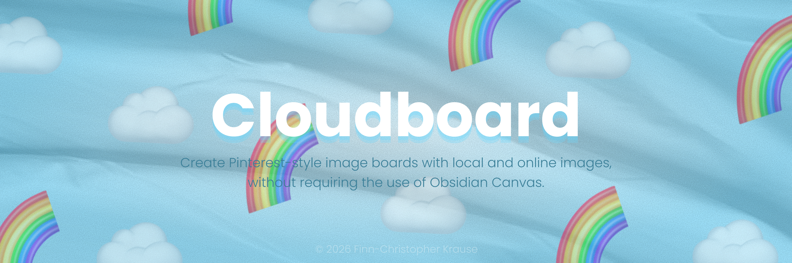
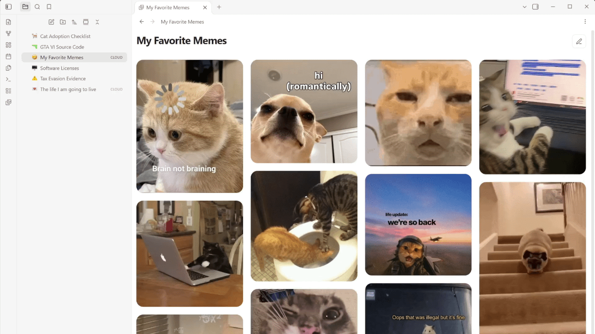
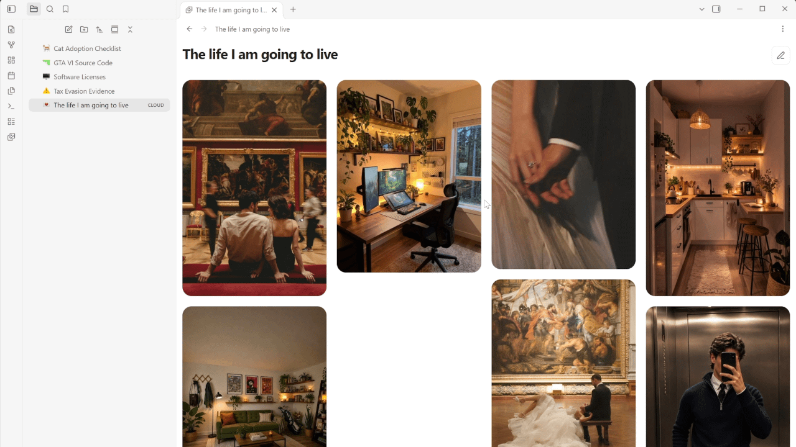

**Create Pinterest-style image boards with both local and online images without requiring the use of Obsidian Canvas.**

Cloudboard provides a clean, pinterest-styke image board for your Obsidian vault with full GIF support. Collect, organize, and browse every image in one place.

## 🖱️ How to use

- After installing and activating Cloudboard, right-click a Markdown note and select **“Convert note into an image board”**. Cloudboard creates a same-named board and moves the original note to Obsidian’s configured trash.
- New and empty boards open automatically in editing mode. Click an **“Add image”** card to add photos from your device or vault, or paste a direct online image link.
- Click the **pencil** in the upper-right corner to **activate editing mode** and add more images, then click the **check mark** to **return to viewing mode.**
- Reorder images by dragging them within or between columns. On touch devices, press and hold before dragging; keyboard users can move focused cards with the arrow keys.

## 💡 Additional info

I’ve added some settings to the plugin menu that let you personalize your Cloudboard experience:
- **Columns:** choose whether your boards use two, three, four or five columns. New installations use four columns by default.
- **Show caption bar:** display captions and image actions below each photo, or disable the caption bar for a cleaner image-only layout.
- **Show asset folder in file explorer:** reveal or hide the `Cloudboard assets` folder. Local photos must remain stored inside the vault so they can be synchronized and displayed across devices. Obsidian would normally show every one of these files in the file explorer, so Cloudboard hides the dedicated asset folder by default while keeping its contents safely stored and synchronized.
- **Language:** choose between English, German, Spanish and French. Your own captions, filenames and other content are not translated.

## 💻 You might also like some other plugins I've made:
- **[TidyTasks](obsidian://show-plugin?id=tidytasks)** - Automatically move completed tasks to the bottom of each Markdown task list, keeping subtasks attached and surrounding text in place.
- **[Notemoji](obsidian://show-plugin?id=notemoji)** - Assign emoji icons to notes and folders in the file explorer to make your vault feel a little cozier.

Thank you for using my plugins and supporting my work! My plugins are designed to work across Windows, macOS, Android, and iOS.

## ⚠️ Feedback and support

Found a bug or have a suggestion? Open an issue in this repository's **GitHub Issues** tab. Include your Obsidian version, device/platform, a small Markdown example and what you expected to happen. Please remove private note content before sharing examples.

Thanks for using my plugins and supporting my work! - Finn

**Disclaimer:** Cloudboard is not affiliated with, endorsed by or sponsored by Pinterest.

